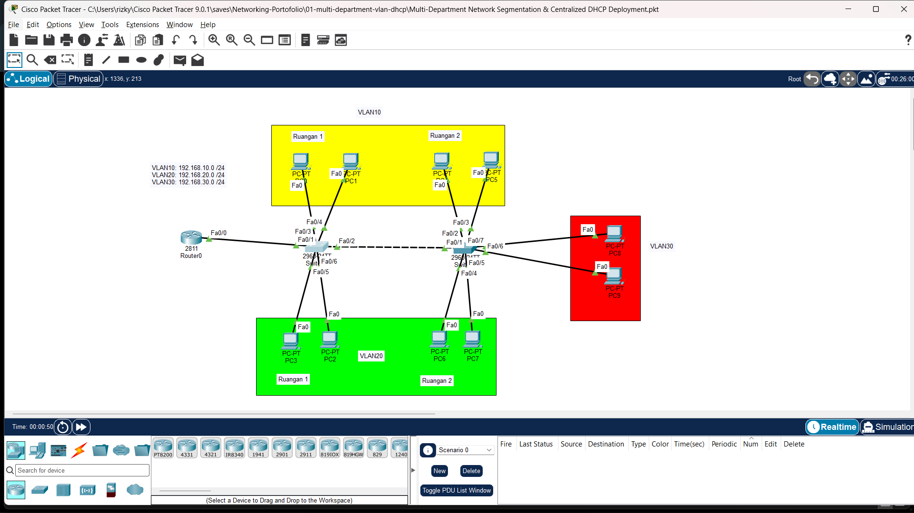

# 🏢 Multi-Department Network Segmentation & Centralized DHCP Deployment

Dokumentasi lab ini membahas implementasi segmentasi jaringan antar-departemen berbasis VLAN menggunakan *Centralized DHCP Server* untuk alokasi IP dinamis secara otomatis.

---

## 🖼️ Topologi Jaringan

---

## 🎯 Tujuan Lab

* Mengisolasi *broadcast domain* antar-departemen menggunakan VLAN.
* Mengkonfigurasi *Trunking* (IEEE 802.1Q) pada penghubung antar-switch.
* Mengkonfigurasi *Centralized DHCP Server* untuk mendistribusikan alamat IP secara otomatis ke tiap VLAN.
* Menguji konektivitas dan isolasi lalu lintas data antar-departemen.

---

## 🛠️ Komponen & File
* **File Simulasi**: `Multi-Department Network Segmentation & Centralized DHCP Deployment.pkt`
* **Gambar Topologi**: `Topology.png`
