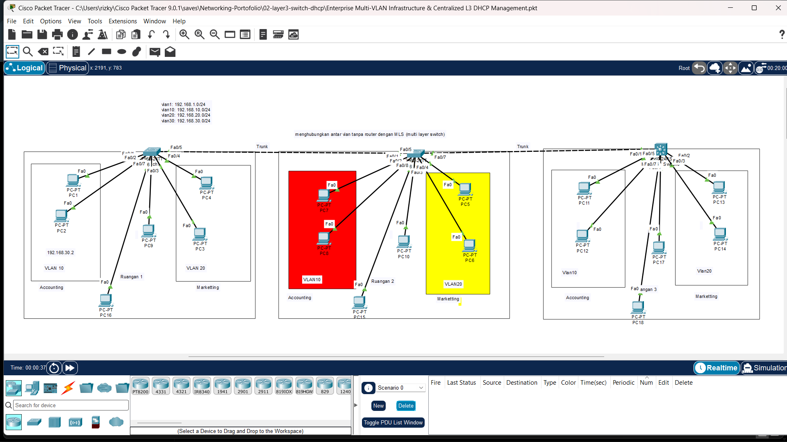

# ⚡ Enterprise Multi-VLAN Infrastructure & Centralized L3 DHCP Management

Lab ini memperagakan penggunaan *Layer 3 Switch* (Multilayer Switch) sebagai pusat routing antar-VLAN (Inter-VLAN Routing) sekaligus sebagai pengelola layanan DHCP tersentralisasi.

---

## 🖼️ Topologi Jaringan

---

## 🎯 Tujuan Lab

* Mengkonfigurasi *Switch Virtual Interface* (SVI) pada Layer 3 Switch sebagai *Default Gateway* tiap VLAN.
* Mengaktifkan *IP Routing* skala *enterprise* pada perangkat Layer 3.
* Menjalankan *Centralized DHCP Pool* secara langsung dari Layer 3 Switch tanpa server eksternal.
* Mengoptimalkan performa inter-VLAN routing dengan kecepatan *wire-speed switching*.

---

## 🛠️ Komponen & File
* **File Simulasi**: `Enterprise Multi-VLAN Infrastructure & Centralized L3 DHCP Management.pkt`
* **Gambar Topologi**: `Topology.png`
