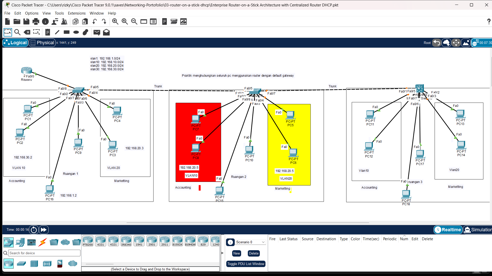

# 🔴 Enterprise Router-on-a-Stick Architecture with Centralized Router DHCP

Lab ini mengimplementasikan metode arsitektur *Router-on-a-Stick* (ROAS) untuk menghubungkan beberapa VLAN menggunakan satu antarmuka fisik router yang dibagi menjadi beberapa *sub-interface*.

---

## 🖼️ Topologi Jaringan

---

## 🎯 Tujuan Lab

* Membuat dan mengkonfigurasi *sub-interfaces* pada antarmuka fisik router.
* Mengkonfigurasi enkapsulasi `dot1q` (IEEE 802.1Q) sesuai dengan ID VLAN masing-masing.
* Membangun layanan *DHCP Server* langsung pada Router untuk setiap *subnet* VLAN.
* Menguji routing antar-VLAN dan alokasi IP otomatis pada *end-devices*.

---

## 🛠️ Komponen & File
* **File Simulasi**: `Enterprise Router-on-a-Stick Architecture with Centralized Router DHCP.pkt`
* **Gambar Topologi**: `Topology.png`
